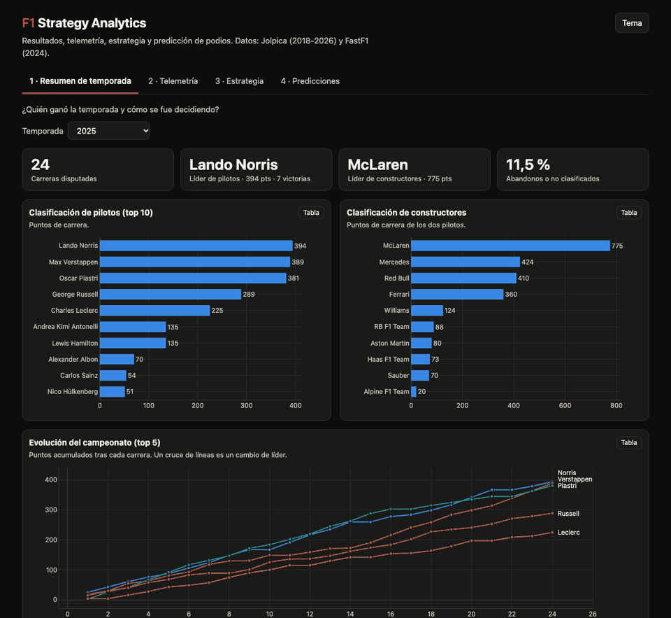

# 🏎️ F1 Strategy Analytics

[](https://github.com/wewesito/f1-strategy-analytics/actions/workflows/update.yml)




Análisis de la estrategia en Fórmula 1 de principio a fin: **datos de carrera y telemetría → degradación de neumáticos y estrategia óptima → predicción de podios → dashboard**, con un pipeline que se actualiza solo cada lunes. Hecho con Python, FastF1, DuckDB, scikit-learn, Plotly y GitHub Actions, más un modelo en estrella listo para Power BI.

> **Pruébalo:** descarga [`reports/dashboard.html`](reports/dashboard.html) y ábrelo en el navegador (es un único archivo, funciona sin conexión). Tiene 4 secciones: resumen de temporada, telemetría, estrategia y predicciones.

## La pregunta

**¿Qué separa a los pilotos y equipos que ganan, y qué estrategia habría sido la óptima en cada carrera?** Y, como pregunta práctica: ¿se puede predecir *antes de la carrera* quién subirá al podio?

## Hallazgos principales

**Predicción de podios**
- **El modelo ordena mejor que una regla simple, pero predice el mismo podio.** En el test de 2025, el Gradient Boosting alcanza un AUC de **0,951** frente a **0,930** de la regla «los 3 primeros de la parrilla hacen podio». Sin embargo, en las **41 carreras** de 2025 y 2026 sus tres elegidos coinciden *exactamente* con los tres primeros de la parrilla. Acierta **54 de 72 podios (75,0 %)** en 2025 y **32 de 51 (62,7 %)** en 2026, igual que la regla simple.
- **La posición de salida concentra casi toda la señal.** Al barajarla, el AUC cae 0,07; la distancia a la pole en clasificación lo hace 0,03; el resto de variables (puntos, forma reciente, historial en el circuito) aporta casi nada una vez conocidas esas dos.
- **El error típico es no saber cuál de los pilotos que salen 4º-6º acabará en el podio**: son dos tercios de los podios que el modelo no ve venir. Los abandonos explican algo más de una cuarta parte de los falsos positivos, y en 1 de cada 4 carreras abandona alguno de los tres pilotos predichos.
- **Una fuga de información es fácil de introducir y difícil de ver.** Añadir una columna con los puntos de la propia carrera lleva el AUC a 1,000; fugas más sutiles (media de temporada completa) lo suben solo 0,01 y no se notan en las métricas. Por eso las variables se validan con una prueba de invarianza (alterar una carrera no puede cambiar las variables de esa carrera ni de las anteriores).

**Estrategia y neumáticos (2024: Baréin, Hungría e Italia)**
- **En Italia la estrategia óptima del modelo era de una parada (H26 → M27)**, y la mejor de dos paradas era peor. Ganó Leclerc con una parada (M15 → H38), a 5,5 s del óptimo simulado, mientras que 6 de los 10 primeros hicieron dos.
- **Los 10 primeros perdieron de media 3,8 s (Baréin), 11,4 s (Italia) y 25,0 s (Hungría) frente a la estrategia óptima simulada.** En Baréin los blandos se degradan más que los duros (0,119 frente a 0,092 s por vuelta).

**Telemetría (clasificación 2024)**
- **En Monza Norris fue 0,134 s más rápido que Leclerc, y la diferencia se concentró en tramos concretos**: Norris ganó 0,235 s entre las curvas 5 y 6, mientras que Leclerc recuperó 0,303 s entre la 3 y la 4. En Suzuka, Verstappen superó a Norris por 0,292 s; en Mónaco, Leclerc a Piastri por 0,154 s.

**Temporada 2025 (puntos de carrera, sin *sprints*)**
- **Tres pilotos llegaron separados por 13 puntos**: Norris 394, Verstappen 389 y Piastri 381. McLaren ganó el campeonato de constructores con 775 puntos frente a los 424 de Mercedes.

## Datos

| Fuente | Contenido | Cobertura |
|---|---|---|
| [Jolpica](https://github.com/jolpica/jolpica-f1) (sucesora de Ergast) | resultados y clasificaciones de **190 carreras** (3.832 resultados) | 2018 a 2026, solo carreras ya disputadas |
| [FastF1](https://docs.fastf1.dev) | vueltas, meteorología, estado de pista, paradas y telemetría | 2024 y 2026 (**37.966 vueltas** limpias) |

## Metodología

1. **Extracción y limpieza** (`src/extract.py`, `clean.py`, `load.py`). Descarga incremental por año. La limpieza descarta vueltas sin tiempo, la primera vuelta, entradas y salidas de boxes, bandera no verde, vueltas anuladas y las que superan el 107 % de la mediana de su carrera y compuesto (en 2024 conserva el 85 % de las vueltas). La meteorología se une a cada vuelta con `merge_asof`. Todo se carga en **DuckDB** y se consulta con SQL (`sql/consultas.sql`).
2. **Telemetría** (`src/telemetry.py`). Compara las vueltas rápidas de dos pilotos: delta de tiempo por distancia con `np.interp`, tiempo ganado en cada tramo entre curvas y mapa de minisectores.
3. **Estrategia** (`src/strategy.py`). Corrige el efecto del combustible (100 kg, 0,03 s/kg), ajusta una recta de degradación por stint, mide la pérdida por parada y **simula todas las estrategias posibles** para encontrar la óptima.
4. **Predicción** (`src/features.py`, `src/model.py`). Clasificación binaria `Podio = Position ≤ 3` con seis variables calculadas solo con información anterior a la carrera (`shift(1)` dentro de cada grupo). División **temporal**: entrenamiento ≤ 2023, validación 2024, test 2025, y 2026 como predicciones «en vivo». Regresión logística, Random Forest y Gradient Boosting con `TimeSeriesSplit` y `RandomizedSearchCV`; interpretación con *permutation importance* y análisis de errores.
5. **Dashboard** (`src/powerbi_export.py`, `src/dashboard.py`). Modelo en estrella (5 dimensiones y 6 tablas de hechos) validado por integridad referencial, guía de Power BI con medidas DAX y un informe HTML interactivo con Plotly.
6. **Automatización** (`src/pipeline.py`, `.github/workflows/update.yml`, `src/summary.py`). Pipeline con `--year`, 43 tests con `pytest`, workflow semanal con commit automático y resumen de la última carrera con la API de Anthropic, a partir solo de los datos del proyecto.

El razonamiento de cada fase está explicado en los notebooks (`notebooks/`) y en [`docs/`](docs).

## Estructura

```
├── data/
│   ├── raw/               # descargas (no se sube a Git)
│   └── processed/         # datos limpios, predicciones y modelo en estrella (powerbi/)
├── notebooks/             # 01 exploración · 02 telemetría · 03 estrategia · 04 predicción
├── src/                   # código reutilizable (extract, clean, load, features, model, pipeline...)
├── sql/                   # consultas DuckDB
├── tests/                 # 43 tests (pytest)
├── models/                # modelo de podios entrenado (joblib)
├── docs/                  # guía de Power BI, automatización y aprendizajes
├── reports/               # dashboard.html, figuras y resúmenes generados
└── .github/workflows/     # actualización semanal
```

## Cómo ejecutarlo

```bash
git clone https://github.com/wewesito/f1-strategy-analytics.git
cd f1-strategy-analytics
python3 -m venv .venv
source .venv/bin/activate
pip install -r requirements.txt

python -m pytest -q                         # tests
python src/pipeline.py --year 2026          # actualiza todo para un año (solo descarga carreras nuevas)
jupyter lab                                 # notebooks
```

Cada notebook empieza subiendo hasta la raíz del proyecto, así que funciona se abra desde donde se abra. La primera ejecución del pipeline descarga toda la temporada y tarda unos minutos; las siguientes solo las carreras nuevas. Para activar la actualización automática y los resúmenes con IA, consulta [`docs/automatizacion.md`](docs/automatizacion.md). Para montar el informe en Power BI: [`docs/powerbi_guia.md`](docs/powerbi_guia.md).

## Limitaciones

- **El modelo de podios no mejora la predicción del podio** frente a la regla de la parrilla; solo ordena mejor al resto de pilotos. No incluye variables de carrera (estrategia, safety cars, fiabilidad por componente, previsión meteorológica) y está entrenado con ~2.500 filas, de las que ~15 % son podios.
- **Las probabilidades no están calibradas** (se entrenó con `class_weight='balanced'`): sirven para ordenar. El modelo no se reentrena cada semana y los cambios de reglamento (2022, 2026) pueden alterar las relaciones aprendidas.
- **La «estrategia óptima» es un modelo simplificado**: degradación lineal y ritmo de un coche típico, sin tráfico, safety cars ni *undercut*. Solo se aplica a tres carreras de 2024, y los compuestos sin degradación fiable (como los blandos de Hungría) se excluyen del modelo.
- **La telemetría integra la distancia de forma algo distinta para cada piloto**, así que la suma de tramos no coincide con el tiempo oficial. El modelo en estrella reparte la discrepancia proporcionalmente a la longitud de cada tramo (supuesto documentado) y conserva el dato original.
- **Los puntos son solo de carrera**: no incluyen los de las *sprints*, por lo que difieren de la clasificación oficial.
- **Cobertura desigual**: vueltas, estrategia y telemetría solo existen para 2024 (y las vueltas, también 2026). En 2026 hay 22 pilotos por carrera, y el modelo solo vio parrillas de hasta 20.
- Los resúmenes generados con IA se redactan solo a partir de los datos que se le entregan al modelo, pero no se verifican automáticamente.

## Agradecimientos

Las técnicas de línea de tiempo común, repetición animada y telemetría en directo se inspiran en [f1-race-replay](https://github.com/IAmTomShaw/f1-race-replay) de Tom Shaw (licencia MIT). Gracias también a los proyectos abiertos [FastF1](https://github.com/theOehrly/Fast-F1) y [Jolpica](https://github.com/jolpica/jolpica-f1), sin los que este análisis no sería posible.

## Autor

**Álvaro Ruiz** · proyecto de portfolio de análisis de datos · [Licencia MIT](LICENSE)
