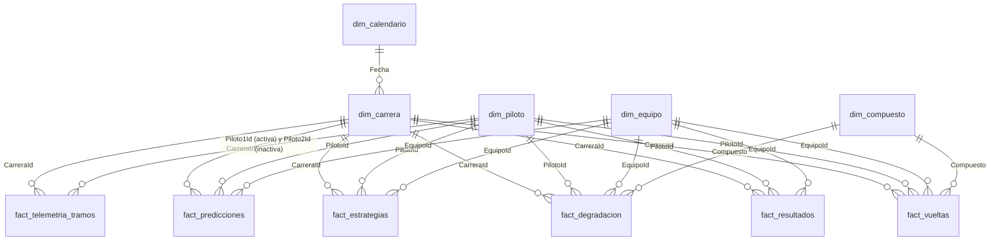

# Modelo en estrella para Power BI

Generado con `python src/powerbi_export.py`. Contiene **5 dimensiones** y **6 tablas de hechos**, en CSV (UTF-8 con BOM) y en un único Excel `modelo_f1.xlsx` con una *Tabla de Excel* por hoja (es el formato que admite Power BI web).

## ¿Qué es un modelo en estrella?

Las tablas de **hechos** guardan eventos medibles (una vuelta, un resultado, una predicción) y muchas filas. Las **dimensiones** describen el contexto (quién, dónde, cuándo) y tienen una fila por elemento. Cada hecho apunta a sus dimensiones mediante una **clave**. En Power BI esa relación hace que, al filtrar por un piloto o un GP, el filtro se propague solo a todos los hechos.

## Relaciones (todas muchos a uno, filtro en un solo sentido: de la dimensión al hecho)

| Desde (lado muchos) | Columna | Hacia (lado uno) | Clave |
|---|---|---|---|
| `dim_carrera` | `Fecha` | `dim_calendario` | `Fecha` |
| todos los `fact_*` | `CarreraId` | `dim_carrera` | `CarreraId` |
| todos los `fact_*` salvo telemetría | `PilotoId` | `dim_piloto` | `PilotoId` |
| `fact_telemetria_tramos` | `Piloto1Id` | `dim_piloto` | `PilotoId` (**activa**) |
| `fact_telemetria_tramos` | `Piloto2Id` | `dim_piloto` | `PilotoId` (**inactiva**) |
| todos los `fact_*` salvo telemetría | `EquipoId` | `dim_equipo` | `EquipoId` |
| `fact_vueltas`, `fact_degradacion` | `Compuesto` | `dim_compuesto` | `Compuesto` |

La telemetría compara dos pilotos, así que hay dos columnas que apuntan a la misma dimensión: es una dimensión de *rol doble*. Solo una relación puede estar activa; la segunda se deja inactiva y se usa en DAX con `USERELATIONSHIP` (ver la guía).

## Claves

- `CarreraId` = año × 100 + ronda (`202416` = ronda 16 de 2024). Es un entero que ordena cronológicamente.
- `PilotoId` = `driverId` de Jolpica (`max_verstappen`). `EquipoId` = `constructorId` (`red_bull`).
- Las claves se validan al exportar: únicas en las dimensiones, sin nulos y sin claves huérfanas en los hechos. Si algo falla, el script no escribe nada.

## Tablas

### Dimensiones
| Tabla | Filas | Contenido |
|---|---|---|
| `dim_calendario` | 3.287 | Un día por fila (2018-2026): `Fecha`, `Anio`, `Mes`, `NombreMes`, `Trimestre`, `AnioMes`. Márcala como tabla de fechas. |
| `dim_carrera` | 190 | `CarreraId`, `Anio`, `Ronda`, `GranPremio`, `Fecha`, `CircuitoId`, `Etiqueta` (ej. `2024 R16 · Italian Grand Prix`). |
| `dim_piloto` | 44 | `PilotoId`, `Abreviatura`, `Piloto`, `Nacionalidad` (valores más recientes). |
| `dim_equipo` | 18 | `EquipoId`, `Equipo` (nombre más reciente). Un cambio de nombre (Alfa Romeo → Sauber) es otro `EquipoId`. |
| `dim_compuesto` | 5 | `Compuesto`, `OrdenCompuesto`, `TipoNeumatico` (Seco/Mojado), `ColorHex` (colores Pirelli). |

### Hechos
| Tabla | Filas | Alcance | Granularidad | Columnas principales |
|---|---|---|---|---|
| `fact_resultados` | 3.832 | 2018-2026 | piloto × carrera | `Posicion`, `Parrilla`, `ParrillaAj` (pit lane = 20), `Puntos`, `Podio`, `Victoria`, `Abandono`, `Estado`, `PosicionesGanadas`, `DifPolePct` |
| `fact_vueltas` | 22.537 | **2024** | vuelta limpia | `Vuelta`, `Stint`, `Compuesto`, `VidaNeumatico`, `TiempoVueltaSeg`, `TiempoCorregidoSeg` (sin efecto del combustible), `Sector1-3Seg`, `Lluvia`, `TempPista`, `TempAire` |
| `fact_estrategias` | 30 | **2024**, 3 GP (Baréin, Hungría, Italia) | piloto × carrera (top 10) | `PosicionFinal`, `Estrategia`, `Paradas`, `VsOptimaSeg` (segundos perdidos frente a la estrategia óptima simulada) |
| `fact_degradacion` | 989 | **2024** | stint | `Stint`, `Compuesto`, `Vueltas`, `DegradacionSegVuelta` |
| `fact_telemetria_tramos` | 51 | **2024**, clasificación de Mónaco, Monza y Suzuka | tramo entre curvas × duelo | `Duelo`, `Tramo`, `OrdenTramo`, `DesdeM`, `HastaM`, `LongitudM`, `GanaP1Seg` (positivo: el piloto 1 gana tiempo) |
| `fact_predicciones` | 853 | **2025-2026** | piloto × carrera | `ProbaPodio`, `ProbaPodioNorm` (suma 3 por carrera), `RankProba`, `PredPodio`, `PredTrivial`, `PodioReal`, `PosicionReal`, `Acierto`, `Conjunto` |

## Cosas que conviene saber

- **No todas las tablas cubren los mismos años.** Resultados, 2018-2026; predicciones, 2025-2026; vueltas, degradación, estrategia y telemetría, solo 2024. En los visuales de esas páginas hay que filtrar por la temporada 2024 o se verán carreras vacías.
- **Puntos:** solo de carreras, no de *sprints*. Por eso, por ejemplo, Verstappen suma 399 en 2024 en lugar de los 437 oficiales.
- **`Acierto`** vale 1 cuando el piloto estaba entre los 3 con más probabilidad y acabó en el podio. `PredTrivial` es la regla "los 3 primeros de la parrilla".
- **Carga en Power BI:** al importar los CSV, fija la configuración regional en *Inglés (Estados Unidos)* para que los decimales con punto no se lean como miles.
